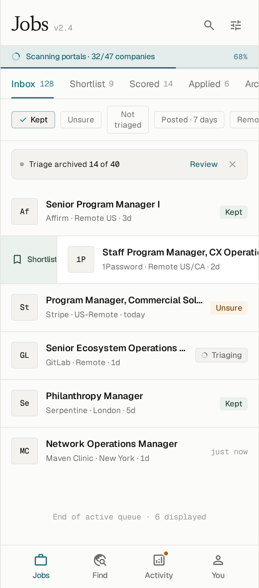

# Winnow

Winnow finds jobs that fit you, scores them against your CV and drafts your applications. It runs on your own computer, and you send every application yourself.

It can also find scholarships and funded master's programmes for you. That mode is in beta.



<!-- Badges go here once public: stars, release, license -->

## The short version

You give Winnow your CV and tell it what you want: the roles, the places, the pay. From then on it:

- collects openings from company careers pages, LinkedIn, job boards and job feeds into one list
- drops the ones that break your rules (title, place, pay, how old the posting is) and notes which rule each broke
- has an AI read every remaining description and keep it, discard it or mark it unsure, with a one-line reason
- scores the ones you keep from 1 to 5 against your CV, with a written report
- drafts a tailored CV and cover letter as PDFs for the jobs you pick

Winnow never applies for you. You read the drafts, change what you want, and send them yourself.

You can install Winnow on your own computer and use it whenever that computer is on. To use it from your phone or away from home, the computer has to stay on and connected, because it acts as the server the app talks to. The AI work goes through OpenCode or Claude Code, so you need one of them and a subscription or credits for the model it uses. Scanning job boards is free; reading, scoring and drafting use AI. Other people can use your server too, each with their own jobs, CV and settings. If someone in your family is job hunting, you just add a profile for them.

An AI assistant can do the setup with you. The prompt is in [Quick start](#quick-start). Winnow is free and open source, and your data stays on your computer.

### Scholarships (beta)

You can set up an account to look for scholarships and funded master's programmes instead of jobs. It works the same way: Winnow finds schemes and programmes, checks whether you're eligible, scores them against your profile, and drafts your essays and motivation letter. This mode is new and hasn't been tested much, so expect rough edges. The details are in [Scholarships mode](#scholarships-mode-beta).

## What you need

- A computer to run it on. Winnow has been tested on a Mac. It should run on Linux and Windows too, but it hasn't been tested there yet; if something breaks, your AI assistant can usually fix it.
- If you want to use it from your phone or away from home, that computer has to stay on. On a Mac, Winnow can start itself again after a restart; on other systems you set that up yourself.
- Node 22 or newer, and pnpm.
- One AI command-line tool, signed in: [OpenCode](https://opencode.ai) or [Claude Code](https://claude.com/claude-code). Winnow does no AI itself; it hands the work to one of these.
- Tectonic and Poppler, if you want tailored CVs and cover letters as PDFs (`brew install tectonic poppler` on a Mac).
- Optionally, headless Chromium (about 170 MB, downloaded once) to read job pages that won't load any other way.

## Quick start

The easiest way to set Winnow up is to let an AI assistant do it with you. These are desktop apps that can run commands on your computer, and they ask before each one.

- If you pay for Claude, download the [Claude desktop app](https://claude.com/download) (Mac and Windows) and open the Code tab.
- If you pay for ChatGPT, get the [ChatGPT desktop app](https://chatgpt.com/download) and open Codex inside it.
- Otherwise, get [OpenCode Desktop](https://opencode.ai/desktop). It has a generous free tier.

### Setting it up

Paste this prompt into your assistant:

```text
Clone Winnow at https://github.com/Itope84/winnow-job-search.
Run scripts/init.sh and walk me through it step by step in plain
language, no jargon. Check each step worked before moving on.
Explain what you are doing before every command, and wait for me to
say "done" when I need to do something in the browser.
Use cheap models where you have a choice. Tell me where in the app
(You › AI) to set them per person.
When the server runs, show me how to open the app on my phone too.
```

Change the prompt to suit you.

What to expect:

1. Your assistant downloads Winnow and installs what it needs. You may have to type your computer password once.
2. The app opens in your browser, and you create your account from the invite link your assistant shows you.
3. The app asks for your CV, a few details, what you're looking for, and five questions. Then it suggests where to look and runs your first scan.
4. Your assistant shows you how to open the app on your phone.

From then on you just open the app.

To keep costs down, point triage and the setup questions at the cheapest model you have, since they run most often. Save the stronger model for scoring and tailored CVs. Board scans themselves use no AI.

### The technical bit

One script checks what's missing, installs Winnow's packages, builds the app and checks the server starts. It's safe to run twice. `--check` only reports what's missing, and `--yes` installs missing Homebrew packages and Chromium for you. It's a Mac and Linux script; on Windows, ask your assistant to run the steps by hand instead.

```bash
git clone https://github.com/Itope84/winnow-job-search.git
cd winnow-job-search
./scripts/init.sh --tunnel tailscale   # or --tunnel cloudflare, or leave it off for home use only
```

The same steps by hand:

```bash
pnpm install
pnpm build:web                          # build the app the server serves
pnpm exec playwright install chromium   # optional: reads stubborn job pages (~170 MB, once)
brew install tectonic poppler           # macOS; needed for PDFs
opencode --version                      # or: claude --version (at least one must work)
pnpm --filter @winnow/server start      # http://localhost:8820, and on your local network
```

To keep it running after a restart on a Mac:

```bash
scripts/install-launchd.sh               # adds the login item com.winnow.server
launchctl kickstart -k gui/$(id -u)/com.winnow.server   # restart it
scripts/install-launchd.sh --uninstall   # remove it
# logs: library/_winnow/server.log
```

On Linux and Windows there's no service file yet. Run the start command under systemd, Task Scheduler or your own process manager, and set `WINNOW_SECURE_COOKIES=1` if it sits behind HTTPS. There's no Docker image yet either.

### Adding people

Accounts are invite-only. Winnow sends no email, so copy the link it prints and send it yourself. People sign in with their username or their email.

```bash
pnpm users add <username> <email> [name] [--admin] [--mode=scholarships]   # prints an invite link
pnpm users invite <id>           # a new link; also resets a forgotten password
pnpm users mode <id> jobs|scholarships
pnpm users email <id> <new email>
pnpm users list
```

The first account becomes the admin. A new person lands in setup after their first sign-in. They can finish it later or go through it again from You › Set up again. Setup's AI runs use the person's default model, so set their models in You › AI before they start.

Coming from career-ops? `pnpm import:career-ops <id> ~/path/to/career-ops` brings over your inbox, tracker, reports, CV, profile and `portals.yml`. Add `--profile-only` to skip the jobs. It only reads from the career-ops folder and is safe to run twice.

### Using it away from home

`./scripts/init.sh --tunnel tailscale` (or `cloudflare`) prints the exact commands for your machine.

Tailscale is the one to use for family. It's private, with no public link. Install it on the server and on every device, signed in to the same account. `tailscale serve` also gives you an HTTPS address, which phones need before they'll install the app or open it offline. It's free for personal use.

A Cloudflare quick tunnel makes a public link in one command, which suits a single remote-help session. Close it when you're done. Sign-in is password only, so anyone who guesses a password on a public link can read that person's CV. For a permanent public address, use a named tunnel with Cloudflare Access in front.

Either way, tell the server the address other devices use, so invite links point there instead of at localhost:

```
WINNOW_PUBLIC_URL=<that address>
```

Behind an HTTPS tunnel, sign-in cookies switch to secure ones on their own.

### Configuration (`.env`, not committed)

| Variable | Default | What it does |
|---|---|---|
| `WINNOW_PORT` | `8820` | Port for the app and the API (`/api`) |
| `WINNOW_HOST` | `0.0.0.0` | Address the server listens on. `127.0.0.1` keeps it to this computer |
| `WINNOW_ROOT` | `./library` | Where everyone's data lives |
| `WINNOW_PUBLIC_URL` | `http://localhost:<port>` | The address put in invite links |
| `WINNOW_MAX_SCANS` / `WINNOW_MAX_AI` | `2` / `5` | Runs at once across everyone. Triage goes ahead of scoring |
| `WINNOW_SECURE_COOKIES` | off | Set `1` behind HTTPS that doesn't send `X-Forwarded-Proto` |
| `WINNOW_REPLAY` | off | A folder of scripted AI runs used instead of a real CLI (tests and demos; no cost) |
| `WINNOW_SKILLS` / `WINNOW_WEB_DIR` | `./skills` / `./apps/app/dist` | Where the AI instructions and the built app are |
| `ADZUNA_APP_ID`, `ADZUNA_APP_KEY`, `CAREERJET_API_KEY` | | Keys for the Adzuna and Careerjet boards, if you use them |

## What Winnow does for you

Paste a job link, or let a scan find jobs, and Winnow works out whether it's worth your evening.

- It checks the posting is still open. If it's closed or gone, the job is archived as closed.
- It filters on your own rules: title words, places, pay and how old the posting is. Each job it filters keeps the rule that caught it.
- It triages what's left: keep, discard or unsure, each with a one-line reason. You review them on one card, with Undo.
- It scores the jobs you keep out of 5, with a written report on why. If a job is below your bar, it tells you to skip it, and you can overrule it.
- One tap drafts a CV and cover letter as PDFs, written from your own history. Anything it isn't sure you can claim is flagged as a stretch for you to check.
- Every job sits in exactly one list (Inbox, Shortlist, Scored, Applied, Archive), and every move records who made it and why. Applied jobs track stages through to Hired.

## Where it looks

| Source | Notes |
|---|---|
| Company careers pages | Greenhouse, Lever, Ashby, Workday, SmartRecruiters, Workable, SuccessFactors and dozens more job systems. Add a company by its careers link, and Winnow says whether it can read it. |
| LinkedIn | Public job search by keywords and place, read past the first page. LinkedIn limits how often one address can search, so busy servers get cut short. |
| Jack & Jill | Connect your Jack account to pull in the roles Jill has matched for you, and to search Jack. |
| AI search | Plain-English queries ("graduate trainee programmes in Lagos") run through your AI tool. |
| Boards | freehire (about 50 job systems in one search), Apple, Google Careers, NHS Jobs, jobs.ac.uk, Jobberman (Nigeria), Adzuna and Careerjet (with keys). |
| Job feeds | Any board's RSS feed, such as HotNigerianJobs or MyJobMag. Winnow reads the role, the company and the place from each item. |
| A link you paste | Any job page. Winnow reads it and sends it through the same checks. |

Copies of the same job from different sources merge, so each job appears once. Winnow also learns the careers feeds of companies it keeps seeing and offers to track them.

## Scholarships mode (beta)

An account can look for scholarships and master's programmes instead of jobs. Pick the mode on the invite (`--mode=scholarships`) and confirm it on the first setup screen. The mode is new and hasn't been tested much yet, so expect rough edges and tell us what breaks.

- You set your nationality, subjects, funding need, English test, work years, and which countries to prefer, allow or exclude.
- Sources include a catalogue of checked scholarship schemes and university pages, country fact cards, RSS feeds, the Erasmus Mundus catalogue, pages Winnow watches for a new round, and an AI search for each place.
- Scholarships and programmes are linked to each other, so a programme shows its ways to pay and a scholarship shows the programmes it covers.
- Triage and scoring check eligibility, fit, funding, odds, place and effort. Each application gets a plan with a checklist, and Winnow drafts essays and a motivation letter from your own words.
- Find › Coverage shows every source and country Winnow has checked, including the ones where it found nothing.

## What Winnow won't do

- Submit applications. It fills in nothing and posts nothing. You click Submit on the employer's site.
- Send email or LinkedIn messages. It only writes drafts, and there's no mail code in the project.
- Phone home. There's no telemetry and no Winnow backend. Your CV goes from your computer to the AI provider you chose and back.
- Make up your history. Tailored CVs are checked against your profile, and shaky lines are flagged as stretches. Read every PDF before you send it.

## Privacy and security

- Everything lives in `library/` on the server: one database per person, plus their job descriptions, reports, tailored documents and CV.
- The AI provider you choose sees your CV and the postings it works on. Nobody else does.
- Sign-in is invite-only, with a password and a session cookie. Writes need an extra header, which stops other websites from sending requests as you.
- Jack & Jill tokens are encrypted with a key kept on the server (`library/_winnow/secret.key`).
- Don't leave a public tunnel open without something like Cloudflare Access in front of it.

Found a security problem? Please report it privately through GitHub's security advisories on this repository rather than in a public issue.

## Features

| Area | What you get |
|---|---|
| Find | Company careers pages, job boards, feeds, LinkedIn, Jack & Jill and AI search. Copies merge. |
| Triage | Keep, Discard or Unsure, each with a reason. Review in one card with Undo. Urgent triage goes ahead of scoring. |
| Score | 1 to 5 across five measures, a verdict from Apply now to Skip, and a full written report. Closing dates and stale postings are flagged. |
| Apply | CV and cover letter as PDFs, cut from your own history, with the layout checked and the source files included so you can edit them. |
| Track | Five lists from Inbox to Archive, application stages up to Hired, a timeline per job, notes, search, bulk moves, and keyboard shortcuts on desktop. |
| Onboard | Guided setup: CV as a PDF or pasted, a few details, five questions, a profile draft you edit, suggested sources, and a first scan. Picks up on any device. |
| Runs | Everything the server does is a stored run, queued with progress and logs. Runs survive a restart and update live in the app. |
| Household | Invite-only sign-in. Each person has their own jobs, CV and settings. The app installs on phones and opens offline, though your data needs a connection. |
| Import | Bring over a career-ops folder: jobs, tracker, reports, CV, profile and sources. Safe to run twice. |

## How it works

```
Your computer (one server, one address: http://localhost:8820)
┌──────────────┐     ┌───────────────────┐     ┌──────────────────────┐
│  App (PWA)   │────▶│ Server            │────▶│ AI tool (OpenCode or │
│ Jobs · Find  │◀────│ Hono + node:sqlite│◀────│ Claude Code)         │
│ Activity·You │ SSE │ jobs · runs ·     │     │ follows skills/,     │
└──────────────┘     │ intake · scans    │     │ writes result.json   │
                     └───────────────────┘     └──────────────────────┘
                       library/users/<id>/  winnow.db, jd/, reports/,
                                            applications/, runs/, profile/
```

- The server holds the data and does the work. The app shows it and sends your decisions. Nothing is scraped from your phone.
- Everything the server does is a run. Runs wait in a scan queue or an AI queue, report progress, and pick up from where they stopped after a restart.
- AI runs write a result file. A skill in `skills/` writes `result.json` (and `report.md` for scoring) in its run folder. The server checks it and saves it in one step, and never reads answers out of chat output.
- Every new job comes in the same way. Winnow removes duplicates by link and by company, role and place, applies your rules, then puts the job in your inbox.

```
packages/api/        shared types: lists, reasons, runs, API shapes (change these first)
apps/server/         Hono on node:sqlite: sign-in, jobs, runs, scans, intake, AI runs, import, live updates
  vendor/career-ops/ career-ops job-board providers, unchanged (MIT)
apps/app/            Expo Router app (web for now): Jobs, Find, Activity, You
skills/              what the AI tool follows: triage, score, tailor, ai-search, scholarship-*, profile-*, …
fixtures/replay/     scripted AI runs for tests
design/              brand (icon, wordmark) and reference screens
docs/                adapters-to-write.md (job systems still to support), the company catalogue
```

## Troubleshooting

| Problem | What to do |
|---|---|
| Invite links open `localhost` on other devices | Set `WINNOW_PUBLIC_URL` in `.env` and restart the server. |
| The app won't install on a phone, or won't open offline | Phones need HTTPS. Use the `tailscale serve` address, not the home IP. |
| A LinkedIn search stopped early | LinkedIn limited the server's address. The run says how far it got. Try again later, or search fewer terms. |
| A job is marked Unsure because its text couldn't be read | Some pages hide the job behind menus or scripts. Install Chromium (`pnpm exec playwright install chromium`), or paste the job text yourself. |
| The first PDF takes minutes | Tectonic downloads its LaTeX packages the first time. Later ones are quick. |
| The server won't start: `EADDRINUSE` | Another copy is already running on port 8820. Stop it, or set `WINNOW_PORT`. |

## Development

```bash
pnpm test        # server tests; they use the replay adapter, never a real AI tool
pnpm typecheck
pnpm lint
node scripts/shot.mjs <url> <email> <password file> <out dir> phone|desktop <paths…>   # screenshots
```

- Contract changes go in `packages/api/src/index.ts` first, then the server, then the app.
- Test skills through OpenCode with a cheap model on a scratch library (`WINNOW_ROOT=…`), never on your real `library/`.
- The app is Expo SDK 57. Read `apps/app/AGENTS.md` and install packages with `npx expo install`.
- Playwright stays on 1.63, to match the installed browsers.
- To add a job board, see `docs/adapters-to-write.md` and `BOARD_CATALOGUE` in `packages/api`.

## Contributing

Use issues for bugs you can reproduce and for work that's been agreed, and Discussions for questions and ideas. Pull requests are welcome; start small. Job hunting is stressful enough, so please be kind.

## License

Winnow is licensed under the [GNU Affero General Public License v3.0](LICENSE). The career-ops code in `apps/server/vendor/career-ops/` keeps its MIT license, and the fonts keep the OFL.

## Winnow and career-ops

I built Winnow on [career-ops](https://github.com/career-ops-hq/career-ops) because some of my family were job hunting and needed an app on their phone instead of a terminal. Some of Winnow's job-board scanners are career-ops' own, kept unchanged in `apps/server/vendor/career-ops/`, and its scoring builds on career-ops' 1 to 5 evaluation. Winnow also reads career-ops' `profile.yml` and `portals.yml`, so you can import your career-ops profile with `pnpm import:career-ops`.

Winnow adds a server that several people can share, an app for your phone, runs that carry on after a restart, triage you review with Undo, more sources (Jack & Jill, Apple, Google, Jobberman and job feeds) and scholarships mode.

career-ops does a lot that Winnow doesn't yet:

- interview prep, practice interviews and debriefs
- finding the hiring manager or recruiter and drafting a message to them
- application emails, and filling in application forms with you
- salary negotiation scripts and help reading an offer
- follow-up reminders, and patterns across your rejections
- deeper research on a company
- running inside Codex and other AI command-line tools, or as a Claude Code plugin

If you're happy working in a terminal with one AI tool, career-ops may suit you better.

## Acknowledgements

Built on [career-ops](https://github.com/career-ops-hq/career-ops) (MIT), for some of Winnow's job-board scanners and its scoring method, and on [ai-job-search](https://github.com/ai-job-search-dev/ai-job-search) (MIT) for sector boards, the posting check and the starting point for LaTeX tailoring. Fonts are Montserrat and Open Sans (OFL), in `skills/tailor/fonts/`.
